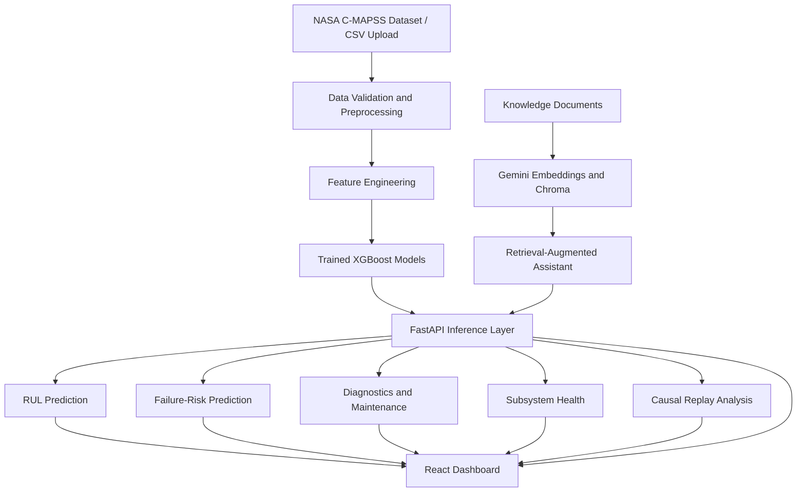

# Vehicle Predictive Maintenance & Diagnostics Platform

### An ML-powered platform for Remaining Useful Life (RUL) prediction, failure-risk estimation, subsystem health monitoring, and predictive maintenance diagnostics.

<p align="center">
  <a href="https://vehicle-pdm-indol.vercel.app/"><strong>Live Dashboard</strong></a> ·
  <a href="https://vehicle-pdm-api.onrender.com/health"><strong>API Health</strong></a> ·
  <a href="https://github.com/Abhyang95/vehicle-pdm"><strong>GitHub Repository</strong></a>
</p>

<p align="center">
  
  
  
  
  
  
</p>

---

## Table of Contents

- [Overview](#overview)
- [Problem Statement](#problem-statement)
- [Project Objectives](#project-objectives)
- [Key Features](#key-features)
- [Live Demo](#live-demo)
- [System Architecture](#system-architecture)
- [End-to-End Workflow](#end-to-end-workflow)
- [Dataset](#dataset)
- [Data Preparation and Leakage Prevention](#data-preparation-and-leakage-prevention)
- [Feature Engineering](#feature-engineering)
- [Machine Learning Models](#machine-learning-models)
- [Model Evaluation](#model-evaluation)
- [Predictive Diagnostics and Maintenance](#predictive-diagnostics-and-maintenance)
- [Causal Replay and Historical Analysis](#causal-replay-and-historical-analysis)
- [Subsystem Health Monitoring](#subsystem-health-monitoring)
- [Explainable AI](#explainable-ai)
- [AI Knowledge Assistant](#ai-knowledge-assistant)
- [REST API Reference](#rest-api-reference)
- [Technology Stack](#technology-stack)
- [Project Structure](#project-structure)
- [Local Installation](#local-installation)
- [Running the Application](#running-the-application)
- [Testing and Verification](#testing-and-verification)
- [Deployment](#deployment)
- [Model Card](#model-card)
- [Limitations](#limitations)
- [Future Improvements](#future-improvements)
- [Key Engineering Challenges](#key-engineering-challenges)
- [Interview Talking Points](#interview-talking-points)
- [Author](#author)

---

## Overview

The **Vehicle Predictive Maintenance & Diagnostics Platform** is a full-stack machine learning application that analyzes engine operating conditions and sensor measurements to estimate equipment degradation, predict Remaining Useful Life (RUL), assess failure risk, and support maintenance decisions.

The platform combines supervised machine learning, causal telemetry replay, subsystem health indicators, diagnostic reporting, and a retrieval-augmented AI assistant in an interactive web application.

The project uses the **NASA C-MAPSS simulated engine degradation dataset** as its primary modeling benchmark. It demonstrates predictive maintenance workflows using simulated engine telemetry rather than real-world vehicle sensor feeds.

### What the platform does

1. Processes engine telemetry and engineered sensor features.
2. Estimates Remaining Useful Life in operating cycles.
3. Predicts the probability of a predefined failure condition.
4. Assigns risk and maintenance severity levels.
5. Analyzes subsystem health using selected sensor groups.
6. Supports CSV uploads and cycle-by-cycle replay analysis.
7. Visualizes predictions, sensor behavior, and historical trends.
8. Provides a knowledge-grounded assistant for interpreting diagnostic results.

The objective is to demonstrate an end-to-end predictive maintenance system, from machine learning development to API integration and a deployed dashboard.

## Problem Statement

Reactive maintenance often identifies equipment problems only after performance has degraded or a failure has occurred. Preventive maintenance based only on fixed schedules can also result in unnecessary servicing or missed degradation events.

Predictive maintenance uses equipment measurements and historical behavior to estimate developing problems and support earlier intervention.

The challenge is to build a system that can:

- Estimate how much useful operating life may remain.
- Distinguish higher-risk operating states from lower-risk states.
- Identify sensor groups associated with potential subsystem degradation.
- Generate useful diagnostic information from telemetry.
- Evaluate historical behavior without using future observations to predict earlier cycles.
- Present technical predictions through an accessible interface.

This project explores these capabilities using a reproducible simulated-engine dataset.

## Project Objectives

- Build separate machine learning models for RUL regression and failure-risk classification.
- Develop a consistent feature pipeline for training and inference.
- Reduce target leakage by excluding features that reveal future engine lifetime.
- Evaluate generalization using engine-level data splits.
- Integrate trained models into a FastAPI backend.
- Build an interactive React dashboard for prediction and diagnostics.
- Implement CSV upload and causal replay workflows.
- Add subsystem health analysis and explainability.
- Integrate a retrieval-augmented assistant for diagnostic questions.
- Deploy the frontend and backend separately.

## Key Features

| Feature | Description |
|---|---|
| RUL prediction | Estimates remaining operating cycles before the modeled end-of-life condition. |
| Failure-risk prediction | Produces a probability for the project's predefined failure target. |
| Risk classification | Maps predicted risk into application-level risk categories. |
| Maintenance prioritization | Generates severity and maintenance-related diagnostic outputs. |
| Subsystem health | Summarizes selected sensor groups into health indicators. |
| CSV upload | Accepts compatible engine telemetry for analysis. |
| Historical replay | Evaluates telemetry at selected operating cycles. |
| RUL validation | Compares predicted and reference RUL where ground truth is available. |
| Health history | Visualizes subsystem health changes over time. |
| SHAP explainability | Supports interpretation of model feature contributions. |
| RAG assistant | Retrieves relevant project knowledge to help explain diagnostics. |
| REST API | Exposes prediction, health, replay, and assistant capabilities. |

## Live Demo

| Resource | Link |
|---|---|
| React dashboard | https://vehicle-pdm-indol.vercel.app/ |
| Backend API | https://vehicle-pdm-api.onrender.com/ |
| API health check | https://vehicle-pdm-api.onrender.com/health |
| GitHub repository | https://github.com/Abhyang95/vehicle-pdm |

**Demo note:** The backend is deployed on Render. Depending on the hosting plan and inactivity, the first request may take longer while the service starts. Uploaded replay sessions are held in application memory and should not be treated as persistent storage.

## System Architecture



### Architecture layers

**1. Data layer**

- NASA C-MAPSS engine degradation data.
- Compatible CSV telemetry uploads.
- Reference RUL labels for supported benchmark replay data.
- Project knowledge documents for retrieval.

**2. Machine learning layer**

- Preprocessing and feature engineering.
- XGBoost RUL regression.
- XGBoost failure-risk classification.
- Feature metadata used to keep inference schemas consistent.
- SHAP-based model explanation support.

**3. Backend layer**

- FastAPI REST endpoints.
- Model loading and inference.
- Risk and severity mapping.
- Diagnostic reporting.
- Subsystem health analysis.
- CSV upload and replay session management.
- Retrieval-augmented assistant integration.

**4. Frontend layer**

- React and Vite.
- API integration through Axios.
- Recharts-based visualizations.
- Replay cycle selection and analysis.
- Health history and RUL validation views.
- Assistant interface.

**5. Deployment layer**

- Vercel for the frontend.
- Render for the backend API.
- GitHub for source control and project documentation.

## End-to-End Workflow

### Step 1 — Load telemetry

The application receives engine telemetry from a compatible CSV file or the project's prepared benchmark data.

### Step 2 — Validate and preprocess

The backend checks the required fields and organizes observations by engine and operating cycle. Unsupported or incomplete telemetry should be rejected rather than silently treated as valid input.

### Step 3 — Engineer features

Sensor measurements and operating settings are transformed into model features. The same feature schema is used by the trained models and inference pipeline.

### Step 4 — Generate predictions

The application runs two predictive tasks:

- RUL regression estimates remaining operating cycles.
- Failure-risk classification estimates the probability of the defined failure target.

### Step 5 — Generate diagnostics

Predictions are combined with application-level thresholds and health indicators to produce risk categories, severity labels, and maintenance-related information.

### Step 6 — Visualize results

The React dashboard presents the selected engine, predictions, health indicators, and available historical trends.

### Step 7 — Analyze historical behavior

The replay workflow evaluates selected cycles using only telemetry available up to the selected cycle. Where supported reference RUL is available, predictions can be compared with the reference values.

### Step 8 — Explain the results

SHAP and the knowledge assistant provide complementary ways to investigate model behavior and understand diagnostic output.

---

## Dataset

### NASA C-MAPSS

This project uses the **Commercial Modular Aero-Propulsion System Simulation (C-MAPSS)** dataset, which contains simulated engine operating conditions and degradation trajectories.

The primary benchmark used is **FD001**.

| Dataset component | Recorded project details |
|---|---|
| Training trajectories | 20,631 rows |
| Training engines | 100 |
| Training cycle range | 1–362 |
| Test replay telemetry | 13,096 rows |
| Test replay engines | 100 |
| Test replay cycle range | 1–303 |
| Reference RUL file | `RUL_FD001.txt` |
| Model RUL cap | 125 cycles |

The FD001 training set contains complete simulated engine trajectories. The test set contains partial trajectories, with a separate reference file providing the remaining useful life at the final observed cycle.

### Why C-MAPSS?

The dataset is useful for predictive maintenance research because it provides:

- Multivariate sensor measurements.
- Operating settings.
- Multiple engine trajectories.
- Simulated degradation behavior.
- Reference remaining-life labels.

### Important data distinction

The benchmark represents **simulated engine degradation**, not actual road-vehicle telemetry, real manufacturer diagnostics, or live fleet data.

The platform demonstrates a workflow that could be adapted to other equipment datasets, but doing so would require appropriate data validation, feature mapping, and model retraining.

## Data Preparation and Leakage Prevention

Reliable evaluation requires more than training a model with a low error score. The feature pipeline must avoid giving the model information that would not be available when a real prediction is made.

### RUL target construction

For a complete training trajectory, the initial RUL target is derived from the engine's last recorded cycle:

\[
RUL_{u,t} = T_u - t
\]

where:

- \(u\) identifies an engine.
- \(t\) is the current operating cycle.
- \(T_u\) is the final recorded cycle for that training trajectory.

The project caps the RUL target at 125 cycles:

\[
RUL^{*}_{u,t} = \min(125,\ RUL_{u,t})
\]

This cap is a modeling choice intended to focus learning on the more informative portion of the degradation trajectory.

For the recognized FD001 replay file, reference RUL is reconstructed using the official final-cycle RUL and the difference between the final observed cycle and the current cycle, subject to the project cap.

Arbitrary CSV uploads do not automatically have trustworthy ground-truth RUL labels. Their predictions should therefore be treated as estimates unless an appropriate reference is provided.

### Engine-level data splitting

The training pipeline uses grouped splitting by engine rather than randomly distributing rows from the same trajectory across training and evaluation sets.

The recorded split is approximately:

| Split | Rows | Purpose |
|---|---:|---|
| Training | 14,607 | Fit model parameters |
| Validation | 2,962 | Compare and tune candidate models |
| Test | 3,062 | Evaluate held-out performance |

The split is organized around engine identities, with 70% / 15% / 15% engine-level allocation.

This prevents observations from one engine trajectory from appearing across multiple partitions and producing an overly optimistic estimate of generalization.

### Excluding future-dependent features

The leakage-safe 143-feature schema excludes features that reveal future trajectory length or final-cycle information, including:

- `cycle`
- `cycle_progress`
- `final_cycle`
- `max_cycle`
- `unit_max_cycle`

Raw engine identifiers, operating settings, and selected sensor measurements remain part of the feature schema.

**Why this matters:** A model should predict using the operating information available at the current point, not hidden information about how long the engine's full trajectory eventually becomes.

## Feature Engineering

The project builds a 143-feature inference schema from engine metadata, operating settings, sensor measurements, and historical sensor behavior.

### Raw inputs

The retained sensor set includes:

`sensor_2`, `sensor_3`, `sensor_4`, `sensor_7`, `sensor_8`, `sensor_9`, `sensor_11`, `sensor_12`, `sensor_13`, `sensor_14`, `sensor_15`, `sensor_17`, `sensor_20`, and `sensor_21`.

The three operating settings are also included.

### Temporal features

Historical sensor windows help describe how measurements evolve instead of relying exclusively on a single observation.

The feature pipeline includes rolling statistics and trend-oriented features over windows of 5, 10, and 20 observations, alongside the relevant raw inputs and settings.

Examples of useful feature families include:

- Recent sensor averages.
- Sensor variability.
- Short-term changes and slopes.
- Operating-setting context.
- Historical behavior within an engine trajectory.

The precise feature schema is stored with model metadata and is used to keep training and inference aligned.

### Causal feature generation

For replay analysis at cycle \(t\), the input history is restricted to observations up to that cycle:

\[
X_t = f(x_1, x_2, \ldots, x_t)
\]

Future observations \(x_{t+1}, x_{t+2}, \ldots\) must not be used to calculate the features for cycle \(t\).

This restriction is important for meaningful historical replay.

### Feature schema consistency

The inference pipeline validates feature names and ordering against the saved model metadata. Schema mismatches must be resolved instead of silently passing incompatible features to a trained model.

---

## Machine Learning Models

The platform uses separate XGBoost models for regression and classification.

### 1. Remaining Useful Life Regression

The RUL model estimates the number of operating cycles remaining before the modeled end-of-life point.

The recorded candidate configuration includes:

| Hyperparameter | Value |
|---|---:|
| Estimator | `XGBRegressor` |
| Number of estimators | 700 |
| Maximum depth | 4 |
| Learning rate | 0.03 |
| Minimum child weight | 5 |
| Subsample | 0.8 |
| Column subsample | 0.8 |
| L1 regularization (`reg_alpha`) | 0.5 |
| L2 regularization (`reg_lambda`) | 5 |
| Random state | 42 |
| RUL cap | 125 |

The model learns nonlinear relationships between sensor behavior, operating conditions, and the RUL target.

The predicted RUL is an estimate, not a guaranteed remaining service interval.

### 2. Failure-Risk Classification

A separate XGBoost classifier estimates the probability of the project's predefined failure condition.

The original target definition uses RUL below 30 cycles as the failure-positive condition. The model probability is subsequently translated into application-level risk categories.

The classifier serves a different purpose from RUL regression:

- RUL regression estimates a remaining-life quantity.
- Classification estimates the likelihood of the defined target event.

These outputs are related but should not be interpreted as interchangeable.

### Risk thresholds

The recorded application-level risk thresholds are:

| Predicted failure probability | Risk category |
|---|---|
| Below 0.15 | Low risk |
| 0.15 to below 0.30 | Watch |
| 0.30 and above | High risk |

The probability thresholds are application configuration choices. They are not universal definitions of mechanical failure.

### Severity mapping

The recorded diagnostic logic assigns severity using predicted probability and/or RUL:

| Severity | Recorded condition |
|---|---|
| Critical | Failure probability ≥ 0.90 or RUL ≤ 7 |
| High | Failure probability ≥ 0.65 or RUL ≤ 15 |
| Medium | Failure probability ≥ 0.35 or RUL ≤ 30 |

The diagnostic severity and risk category are distinct. A diagnostic can indicate concerning health or short estimated life even when the classifier's probability is low.

---

## Model Evaluation

The project records more than one evaluation setup. The metrics below are intentionally presented separately because they come from different evaluation contexts.

### A. Official FD001 benchmark evaluation

The recorded official FD001 evaluation summary is:

| Metric | Recorded result |
|---|---:|
| RUL MAE | 12.6691 cycles |
| RUL RMSE | 17.1899 cycles |
| RUL \(R^2\) | 0.8289 |
| Failure precision | 0.8750 |
| Failure recall | 0.8400 |
| Failure F1-score | 0.8571 |

The RUL metrics quantify regression error on the benchmark evaluation. Lower MAE and RMSE indicate smaller errors; higher \(R^2\) indicates a stronger fit relative to the evaluation target's variance.

Precision, recall, and F1 describe the failure classifier under its evaluation setup.

### B. Grouped unit-held-out evaluation

The recorded candidate RUL model produced the following results in the engine-grouped split pipeline:

| Split | MAE (cycles) | RMSE (cycles) | \(R^2\) |
|---|---:|---:|---:|
| Training | 6.1058 | — | — |
| Validation | 11.6363 | 16.3933 | 0.8461 |
| Test | 10.1150 | 14.4039 | 0.8807 |

The recorded failure classifier results for this pipeline were:

| Split | F1-score |
|---|---:|
| Validation | 0.8955 |
| Test | 0.9038 |

These values belong to the grouped unit-held-out pipeline and should not be combined with the official benchmark results into one metric table.

### C. Evaluation methodology

The project uses:

- MAE to quantify average absolute RUL error.
- RMSE to penalize larger regression errors more strongly.
- \(R^2\) to assess explained target variance.
- Precision and recall to assess failure classification.
- F1-score to summarize the precision-recall balance.
- Engine-level data splitting to evaluate generalization to unseen engine trajectories.
- Pipeline parity checks to compare feature generation across relevant inference paths.

### Example official benchmark predictions

The recorded examples below illustrate how predictions compare with the benchmark reference values.

| Engine | Final observed cycle | Reference RUL | Predicted RUL |
|---|---:|---:|---:|
| Unit 1 | 31 | 112 | 119.249 |
| Unit 10 | 192 | 96 | 90.777 |
| Unit 100 | 198 | 20 | 12.596 |

These are examples from the official test-engine evaluation. They are not interchangeable with predictions from a different training trajectory, uploaded CSV, or model checkpoint.

### Interpreting the results

Good benchmark performance does not establish that the model is ready for safety-critical maintenance decisions. Additional validation is needed on representative real-world equipment data before operational deployment.

---

## Predictive Diagnostics and Maintenance

The platform combines model outputs with diagnostic rules to make predictions easier to interpret.

### Diagnostic outputs

Depending on the endpoint and available telemetry, the backend can provide:

- Predicted RUL.
- Failure-risk probability.
- Risk category.
- Diagnostic severity.
- Subsystem health indicators.
- Sensor-related diagnostic context.
- Maintenance-related information.

### Risk and severity are not identical

The dashboard distinguishes between the classifier's probability-based risk assessment and other diagnostic indicators.

For example, a subsystem health indicator can be poor while the classifier probability remains low. This does not automatically mean one output is incorrect: the indicators measure different things and use different rules.

The outputs should be interpreted together rather than treating any single label as a definitive mechanical diagnosis.

### Intended use

The platform is designed for predictive maintenance demonstration, model evaluation, and diagnostic decision support. Its outputs should not independently determine whether a real vehicle or machine is safe to operate.

## Causal Replay and Historical Analysis

The replay workflow allows a user to upload compatible telemetry, select an engine, and analyze its behavior at a chosen operating cycle.

### Replay workflow

1. Upload a compatible CSV.
2. Select an engine from the uploaded dataset.
3. Choose a cycle to analyze.
4. Build the available history up to that cycle.
5. Run inference and diagnostic calculations.
6. Review the resulting predictions and historical charts.

### Why causal replay matters

When analyzing a historical cycle, the system should not use measurements from later cycles. The replay pipeline truncates the selected engine's history at the cycle being evaluated before generating the relevant features and predictions.

This makes the replay more representative of a prediction made at that point in time.

### Ground-truth availability

The recognized `fd001_test_replay.csv` dataset can use `RUL_FD001.txt` to reconstruct benchmark reference RUL values.

For an arbitrary uploaded CSV, the system cannot assume that true RUL is known. A chart should only show reference RUL when valid ground truth is available.

### Performance optimization

Historical analysis can be computationally expensive when feature engineering is repeated for every cycle. The project includes an optimization to compute vehicle-health history features more efficiently and avoids unnecessary SHAP calculations for historical points.

The replay implementation uses a bounded history of up to 20 cycles for the relevant history-based analysis.

### Session behavior

Replay session state is held in application memory. Restarting the backend can clear uploaded sessions, and multiple application instances would require shared persistence for reliable cross-instance session access.

---

## Subsystem Health Monitoring

The platform derives approximate subsystem health indicators from selected sensor groups.

The current mapping is:

| Subsystem group | Selected sensors |
|---|---|
| Temperature | Sensors 2, 3, 4 |
| Pressure | Sensors 7, 11 |
| Speed / Flow | Sensors 8, 9, 12, 13, 14, 15 |
| Thermal / Bleed | Sensors 17, 20, 21 |

The dashboard can use these indicators to summarize sensor-group behavior and display historical health trends.

### Interpretation

These groupings are engineering-oriented approximations for the project. They are not validated component-level fault-isolation models and should not be presented as proof that a specific physical part has failed.

Health scores are application-defined indicators. They should be interpreted alongside raw measurements, predicted RUL, failure risk, and diagnostic context.

## Explainable AI

The project integrates SHAP to support model interpretation.

SHAP-based analysis helps investigate how input features contribute to a model's prediction under the chosen explanation method.

Potential uses include:

- Investigating influential sensor features.
- Comparing feature contributions across observations.
- Understanding why predictions change.
- Supporting debugging and model validation.

### Important distinction

Feature contribution is not the same as physical causation. A sensor feature that strongly influences a prediction does not, by itself, establish the root cause of an actual mechanical problem.

Historical replay avoids unnecessary SHAP computations where explanations are not required, helping reduce the cost of repeated analysis.

## AI Knowledge Assistant

The application includes a retrieval-augmented generation (RAG) assistant intended to explain diagnostic information using project knowledge.

### Architecture

The recorded implementation uses:

- Gemini for language-model integration.
- Gemini embeddings for document retrieval.
- Chroma as the vector database.
- Project knowledge documents under `docs/knowledge`.
- A FastAPI assistant endpoint.
- Diagnostic context supplied by the application.

The project vector collection is named `vehicle_pdm_knowledge`.

### RAG workflow

1. Knowledge documents are prepared and split into chunks.
2. Document chunks are embedded.
3. The embeddings and associated text are stored in Chroma.
4. A user asks a diagnostic or project-related question.
5. Relevant context is retrieved from the knowledge collection.
6. The assistant generates an answer using retrieved knowledge and the supplied diagnostic context.

### Diagnostic context priority

The assistant is intended to use the current diagnostic state as the authoritative source for the selected analysis. Explanations should preserve distinctions between RUL, classifier probability, severity, and subsystem health.

For example, a critical health indicator should not automatically be described as a high classifier probability if the returned probability is low.

### Scope and limitations

The assistant is a supporting explanation layer, not a replacement for the prediction models or a certified maintenance expert. Its answers depend on the available documentation, retrieved context, and supplied diagnostic state.

---

## REST API Reference

**Base URL:** `https://vehicle-pdm-api.onrender.com`

Interactive API documentation, when enabled in the deployment, is available at:

`https://vehicle-pdm-api.onrender.com/docs`

### Endpoint overview

| Method | Endpoint | Purpose |
|---|---|---|
| GET | `/health` | Check API and model health |
| GET | `/model-info` | Inspect model and feature configuration metadata |
| POST | `/predict` | Generate predictive outputs |
| POST | `/diagnostics` | Generate diagnostic information |
| POST | `/maintenance` | Return maintenance-related results |
| GET | `/vehicle/{unit}/health` | Retrieve vehicle/engine health information |
| GET | `/vehicle/{unit}/telemetry` | Retrieve available telemetry |
| POST | `/upload-csv` | Upload compatible telemetry for replay |
| GET | `/replay/{session_id}` | Retrieve replay session information |
| POST | `/replay/{session_id}/analyze` | Analyze a replay session at selected cycles |
| POST | `/assistant` | Submit a question to the knowledge assistant |

Consult the deployed OpenAPI schema for the exact request fields, response schemas, and accepted parameters for each endpoint.

### 1. Health check

```http
GET /health
```

Example:

```bash
curl https://vehicle-pdm-api.onrender.com/health
```

The health endpoint reports whether the service is healthy and whether the expected model artifacts are available.

### 2. Model information

```http
GET /model-info
```

This endpoint exposes supported model and feature configuration metadata. The recorded configuration includes the 143-feature schema, RUL cap, failure target threshold, and replay/upload capability flags.

### 3. Prediction

```http
POST /predict
```

Generates model predictions from a supported telemetry input. Refer to `/docs` for the exact request body required by the deployed version.

### 4. Diagnostics

```http
POST /diagnostics
```

Returns diagnostic information derived from the supported prediction and telemetry inputs.

### 5. Maintenance

```http
POST /maintenance
```

Provides the application's maintenance-related analysis. Returned recommendations should be interpreted as decision support rather than authoritative repair instructions.

### 6. Vehicle health

```http
GET /vehicle/{unit}/health
```

Retrieves health information for the requested engine or unit, subject to the data available to the running application.

### 7. Telemetry

```http
GET /vehicle/{unit}/telemetry
```

Retrieves available telemetry for the selected unit.

### 8. CSV upload

```http
POST /upload-csv
```

Uploads a compatible telemetry CSV and creates a replay session.

The current replay input expects an engine identifier, cycle, three operating settings, and the supported sensor fields. The required fields are:

```text
unit
cycle
setting_1
setting_2
setting_3
sensor_2
sensor_3
sensor_4
sensor_7
sensor_8
sensor_9
sensor_11
sensor_12
sensor_13
sensor_14
sensor_15
sensor_17
sensor_20
sensor_21
```

Use the deployed API schema and the project's current preprocessing implementation to confirm exact CSV formatting requirements before uploading another dataset.

### 9. Replay analysis

```http
POST /replay/{session_id}/analyze
```

Analyzes the selected replay session at the requested cycle or cycles according to the accepted request schema.

### 10. Knowledge assistant

```http
POST /assistant
```

Accepts an assistant request and uses the application's supported diagnostic context and knowledge retrieval pipeline.

---

## Technology Stack

| Category | Technology | Role |
|---|---|---|
| Language | Python 3.11 | Backend and ML development |
| API framework | FastAPI | REST API and model serving |
| Validation | Pydantic | Request and response validation |
| Data processing | Pandas, NumPy | Tabular processing and feature engineering |
| Machine learning | XGBoost | RUL regression and failure classification |
| Evaluation | scikit-learn | Metrics and model evaluation |
| Explainability | SHAP | Feature-contribution analysis |
| Frontend | React | Dashboard interface |
| Frontend tooling | Vite | Development server and build tooling |
| HTTP client | Axios | Frontend API requests |
| Visualization | Recharts | Prediction and health charts |
| LLM integration | Gemini | Knowledge assistant generation and embeddings |
| Vector database | Chroma | Knowledge retrieval |
| Testing | pytest | API and replay verification |
| Frontend hosting | Vercel | Dashboard deployment |
| Backend hosting | Render | API deployment |
| Version control | Git and GitHub | Source control and collaboration |

---

## Project Structure

The following is a high-level representation of the project. Individual files may vary as the implementation evolves.

```text
vehicle-pdm/
│
├── api/
│   └── main.py
│
├── data/
│   ├── raw/
│   │   └── cmapss/
│   ├── processed/
│   └── vectorstore/
│
├── docs/
│   └── knowledge/
│
├── frontend/
│   └── src/
│       ├── assets/
│       ├── services/
│       └── App.jsx
│
├── models/
│   ├── xgboost_failure_risk.joblib
│   ├── rul_xgboost.joblib
│   ├── failure_risk_features.json
│   └── rul_features.json
│
├── notebooks/
│
├── src/
│   ├── preprocessing.py
│   ├── feature_engineering.py
│   ├── train_rul_xgboost.py
│   ├── inference.py
│   ├── diagnostic_report.py
│   ├── subsystem_health.py
│   └── vehicle_health.py
│
├── tests/
│   ├── test_api_regression.py
│   ├── test_replay_consistency.py
│   ├── test_replay_history_api.py
│   └── test_vehicle_health_history.py
│
├── requirements.txt
├── render.yaml
└── README.md
```

### Main components

- `api/main.py` — FastAPI application and API routes.
- `src/preprocessing.py` — data preparation and preprocessing.
- `src/feature_engineering.py` — model feature generation.
- `src/train_rul_xgboost.py` — RUL model training workflow.
- `src/inference.py` — inference feature construction and prediction support.
- `src/diagnostic_report.py` — diagnostic reporting logic.
- `src/subsystem_health.py` — subsystem health calculations.
- `src/vehicle_health.py` — vehicle health and history analysis.
- `frontend/src/App.jsx` — main React dashboard.
- `models/` — trained models and feature schema metadata.
- `tests/` — automated regression and replay checks.
- `docs/knowledge/` — knowledge documents used by the assistant.

The file tree above is representative; use the actual repository when verifying filenames or adding new modules.

---

## Local Installation

### Prerequisites

Install the following before running the project:

- Python 3.11.
- Node.js and npm.
- Git.
- The project source code.
- The required dataset and model artifacts, where applicable.

### 1. Clone the repository

```bash
git clone https://github.com/Abhyang95/vehicle-pdm.git
cd vehicle-pdm
```

### 2. Create a Python virtual environment

**Windows PowerShell**

```powershell
python -m venv .venv
.\.venv\Scripts\Activate.ps1
```

If PowerShell blocks environment activation, use an approved local execution-policy adjustment or invoke the environment's Python executable directly.

### 3. Install Python dependencies

```powershell
python -m pip install --upgrade pip
pip install -r requirements.txt
```

If the project requires model or data files that are not tracked in Git, obtain those files from the project's documented source before starting inference.

### 4. Configure environment variables

Create a local `.env` file or configure environment variables according to the current backend configuration.

The knowledge assistant requires appropriate Gemini credentials and model configuration if that feature is to be enabled.

**Security:** Never commit API keys, private credentials, or local environment files to GitHub.

### 5. Install frontend dependencies

```powershell
cd frontend
npm install
cd ..
```

---

## Running the Application

### Start the backend

From the repository root, activate the Python virtual environment and run:

```powershell
uvicorn api.main:app --reload --host 127.0.0.1 --port 8000
```

Backend URL:

`http://127.0.0.1:8000`

API documentation:

`http://127.0.0.1:8000/docs`

Health check:

`http://127.0.0.1:8000/health`

### Start the frontend

Open a second terminal:

```powershell
cd frontend
npm run dev
```

The configured development frontend uses:

`http://localhost:5173`

The frontend API configuration must point to the appropriate backend URL. The local development setup uses `http://127.0.0.1:8000`; the deployed application uses the hosted API.

### Verify the setup

1. Open the backend health endpoint.
2. Confirm the expected model artifacts are loaded.
3. Open the frontend.
4. Check that the dashboard can reach the backend.
5. Test a supported prediction request.
6. Upload a compatible CSV and verify replay analysis.
7. Confirm that the assistant is configured before testing RAG functionality.

---

## Testing and Verification

The project includes automated tests for API contracts, replay consistency, historical analysis, and regression behavior.

### Test suite

Run the complete test suite:

```powershell
python -m pytest tests -v
```

Run the replay consistency tests:

```powershell
python -m pytest tests/test_replay_consistency.py -v
```

Run API regression tests:

```powershell
python -m pytest tests/test_api_regression.py -v
```

Run replay history API tests:

```powershell
python -m pytest tests/test_replay_history_api.py -v
```

Run vehicle-health history tests:

```powershell
python -m pytest tests/test_vehicle_health_history.py -v
```

### Verification areas

| Test area | What it checks |
|---|---|
| API regression | Prediction and diagnostic contracts |
| Replay consistency | Consistency between full-history and truncated-history feature paths |
| Replay history API | Historical replay endpoint behavior |
| Vehicle health history | Health-history computation and response behavior |
| Feature schema | Consistency between model metadata and inference features |
| Deployment health | Availability of the API and expected model artifacts |

### Recorded test status

During development, the following focused test results were recorded:

- Replay consistency: 8 tests passed.
- API regression: 6 tests passed.
- Replay history API: 1 test passed.
- A later focused verification run reported 20 passed tests and 4 warnings.

These are historical development results, not a claim that every test has been rerun against the latest repository state. Run the commands above to verify the current checkout.

### Manual deployment checks

- Check `/health` after deployment.
- Check `/model-info` for the expected model metadata.
- Confirm that a supported prediction request completes.
- Upload a compatible dataset and analyze a cycle.
- Confirm that historical charts contain the expected points.
- Verify that reference RUL appears only when ground truth is available.
- Confirm that the deployed frontend uses the deployed API.

---

## Deployment

### Frontend — Vercel

The React/Vite frontend is deployed on Vercel.

Live application:

https://vehicle-pdm-indol.vercel.app/

When configuring a new frontend deployment, verify the project root, build command, output directory, and backend API URL against the repository's current Vite configuration.

### Backend — Render

The FastAPI backend is deployed on Render.

API:

https://vehicle-pdm-api.onrender.com/

Health:

https://vehicle-pdm-api.onrender.com/health

The backend requires its Python dependencies, model artifacts, and appropriate environment variables to be available in the deployed environment.

### Deployment considerations

- The backend must load compatible model files and feature metadata.
- The frontend must target the correct API base URL.
- CORS must permit the frontend origin.
- Secrets must be configured as environment variables.
- The knowledge assistant requires its provider credentials and vector-store configuration.
- In-memory replay sessions are not durable across restarts.
- Free-tier hosting may introduce cold starts or limited compute resources.

### Production-readiness considerations

A more robust production deployment would require persistent session storage, stronger observability, explicit model versioning, security review, realistic operational validation, and appropriate reliability controls.

---

## Model Card

| Field | Description |
|---|---|
| Model purpose | Estimate engine RUL and failure risk from telemetry |
| Model types | XGBoost regression and classification |
| Primary dataset | NASA C-MAPSS FD001 |
| Input | Operating settings and selected sensor-derived features |
| Feature count | 143 |
| RUL target cap | 125 cycles |
| Failure target | RUL below 30 cycles |
| Outputs | RUL estimate, failure probability, diagnostic indicators |
| Intended use | Demonstration, research, and predictive maintenance decision support |
| Not intended for | Autonomous safety decisions or unvalidated real-world maintenance deployment |

### Evaluation

The project reports official FD001 benchmark metrics and separate grouped unit-held-out metrics. Their evaluation contexts should be preserved when comparing models or presenting results.

### Known risks

- Simulated training data may not represent real equipment.
- Sensor distributions may change between datasets.
- Prediction uncertainty is not fully captured by a single point estimate.
- A low predicted failure probability does not prove an engine is healthy.
- An approximate subsystem health score does not establish a physical fault.
- Performance on held-out simulated engines does not guarantee performance on operational vehicles.

### Responsible use

Use the system as an analytical aid. Validate the model on representative target-equipment data and involve qualified maintenance personnel before applying predictions to real maintenance decisions.

---

## Limitations

1. **Simulated data:** The main benchmark uses NASA C-MAPSS rather than a real vehicle fleet.
2. **No live IoT ingestion:** The current workflow focuses on CSV upload and historical replay.
3. **Model generalization:** Results on FD001 may not transfer to different engine types or operating environments.
4. **Point predictions:** RUL estimates do not automatically provide calibrated uncertainty intervals.
5. **Approximate subsystem mapping:** Sensor groups are not validated physical fault-isolation systems.
6. **Application-defined thresholds:** Risk and severity thresholds require appropriate calibration for any operational setting.
7. **Ground-truth dependency:** Reference RUL is available only for datasets with appropriate labels.
8. **In-memory sessions:** Uploaded replay sessions may be lost when the backend restarts.
9. **Assistant reliability:** Generated explanations depend on retrieved knowledge and available context.
10. **Hosting constraints:** Cold starts and limited resources can affect response time.

---

## Future Improvements

### Machine learning

- Evaluate additional degradation datasets and operating conditions.
- Add prediction intervals or calibrated uncertainty estimates.
- Evaluate alternative model families against the same engine-level splits.
- Improve probability calibration and threshold selection.
- Expand drift detection and model monitoring.
- Validate predictions against representative real-world telemetry.

### Backend and data engineering

- Add persistent replay-session storage.
- Add asynchronous execution for expensive analysis.
- Introduce model versioning and reproducible experiment tracking.
- Improve structured logging and performance observability.
- Add explicit data-quality and schema-version checks.

### Frontend

- Improve engine and dataset selection workflows.
- Add clearer distinctions between uploaded datasets and individual engines.
- Improve error messages and loading states for long-running analyses.
- Add richer historical comparisons and prediction uncertainty displays.

### AI assistant

- Improve retrieval evaluation and document coverage.
- Add citations to retrieved knowledge where supported.
- Evaluate response consistency against diagnostic state.
- Add safeguards against unsupported repair recommendations.

### Deployment and operations

- Add automated CI checks for tests and feature-schema compatibility.
- Add persistent storage and stronger access controls.
- Add health monitoring and deployment smoke tests.
- Evaluate containerized deployment where useful.

---

## Key Engineering Challenges

### 1. Preventing target leakage

Predictive maintenance models can appear highly accurate if features contain information about the eventual end of an engine's trajectory.

The project uses an engine-level split and removes known future-dependent fields from the 143-feature schema. This helps produce a more credible evaluation of predictions for unseen engine trajectories.

### 2. Keeping training and inference consistent

A trained model expects the feature names and ordering it saw during training.

The project maintains feature metadata and validates the inference schema, reducing the risk of silently generating incorrect predictions from mismatched inputs.

### 3. Building causal replay

Historical analysis must represent what the system could have known at a selected operating cycle.

The replay pipeline restricts telemetry to the selected cycle and computes the relevant features from that available history.

### 4. Reducing historical analysis cost

Repeated feature computation and model explanations can make replay slow.

The project optimizes health-history feature computation and avoids unnecessary SHAP analysis for historical points, improving efficiency while preserving the intended analysis workflow.

### 5. Integrating separate prediction signals

RUL, failure probability, severity, and subsystem health measure different aspects of the modeled state.

The diagnostic layer preserves these distinctions instead of treating a single probability as a complete description of engine condition.

### 6. Combining ML with a knowledge assistant

A useful assistant must explain predictions without overriding the application's actual diagnostic state.

The RAG integration separates retrieved project knowledge from the current diagnostic context, providing a foundation for more consistent technical explanations.

---

## Interview Talking Points

**Why use XGBoost?**

XGBoost is effective for structured tabular data and can model nonlinear relationships between sensor features and degradation targets. It also supports a practical CPU-based training and inference workflow.

**Why separate regression and classification?**

RUL regression estimates remaining operating cycles, whereas classification estimates the probability of a predefined failure target. They answer different questions and can complement each other in a maintenance workflow.

**How was leakage addressed?**

The project uses engine-level data splitting and excludes known future-dependent trajectory features from its leakage-safe feature schema.

**Why use engine-level splitting?**

Rows from the same engine trajectory are correlated. Splitting by engine reduces the risk of train/test contamination from the same engine and provides a more meaningful estimate of generalization.

**Why is causal replay important?**

A historical prediction should use only measurements available at that time. Truncating telemetry at the selected cycle avoids using future observations to construct the replay input.

**What is the difference between RUL and failure probability?**

RUL is a regression estimate measured in operating cycles. Failure probability is a classifier output tied to the defined target and model calibration. Neither is a guarantee of future equipment behavior.

**Why add SHAP?**

SHAP helps investigate which features influence predictions, supporting model debugging and interpretation. It does not prove physical causation.

**Why use RAG?**

RAG retrieves relevant knowledge documents before generating an explanation. This can help connect diagnostic output to project-specific documentation, although it does not guarantee that every generated statement is correct.

**What was an important performance optimization?**

Reducing repeated feature computation in vehicle-health history analysis and skipping unnecessary historical SHAP calculations helped make repeated replay analysis more efficient.

**What would be required before real-world deployment?**

Representative operational data, external validation, uncertainty estimates, probability calibration, persistent data storage, monitoring, security controls, and expert review of maintenance decisions.

---

## Author

**Abhyang**

GitHub: https://github.com/Abhyang95

### Project Links

- **Live Dashboard:** https://vehicle-pdm-indol.vercel.app/
- **Backend API:** https://vehicle-pdm-api.onrender.com/
- **API Health:** https://vehicle-pdm-api.onrender.com/health
- **Source Code:** https://github.com/Abhyang95/vehicle-pdm

---

*Built as an end-to-end machine learning and full-stack engineering project exploring predictive maintenance, time-series feature engineering, model evaluation, causal replay, explainability, and retrieval-augmented AI.*